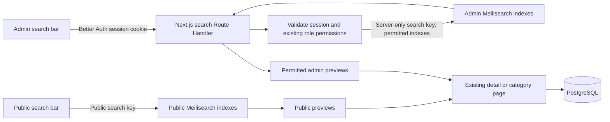
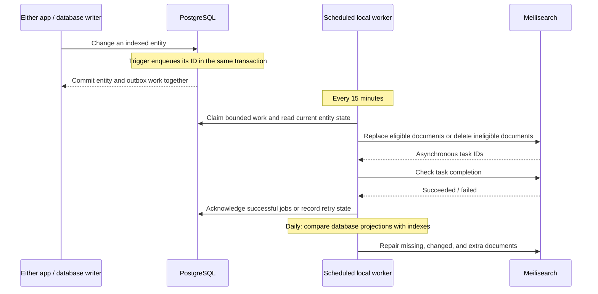

**Search architecture and contracts**

Search is an English-only navigation feature. Results are small previews that
open existing pages; they are not catalog pages or a source of live stock,
pricing, checkout validation, or authorization data.

Phases 1 and 2 provide the contracts, index settings, persistent local service,
initialization, document projections, and population/rebuild commands. Database
triggers, automatic synchronization, search endpoints, and the interfaces are
subsequent phases. Initializing indexes alone does not populate them, and these
tooling commands do not add a working search bar.

**Why Meilisearch**

PostgreSQL full-text search with `pg_trgm` would be sufficient at this project's
scale. Meilisearch is a deliberate portfolio choice: it demonstrates typo-tolerant
search, an external read model, asynchronous synchronization, and recovery from
missed or failed updates. It adds another service and accepts eventual consistency;
it is not a claim that PostgreSQL cannot handle the workload.

PostgreSQL remains the source of truth. Meilisearch stores only documents needed
to find and preview an entity. Catalog loading, category filtering, pagination,
product details, and checkout continue using their existing PostgreSQL queries.
The worker will have separate queries for building search documents; it will not
reuse page-loading queries that return variant trees or depend on a user session.

**Request flow**



The public browser can query Meilisearch directly because everything in its two
indexes is public. Its search key is intentionally visible and must be limited to
the `search` action on those indexes. UI filters and requested attributes are not
access controls: visitors can construct their own requests.

The admin Route Handler checks the Better Auth session once, evaluates the
existing role definitions in code, and selects permitted indexes and fields.
Meilisearch validates the server's API key; it does not understand Better Auth
sessions or look up application users. The handler must enforce access itself
because the server credential can search all five admin indexes.

Use a Route Handler for these read requests so the UI can cancel outdated requests.
Search never requires a Server Action. The public and admin adapters remain
separate even when the presentation components are shared.

**Public contract**

| Index | Searchable fields, in priority order | Preview | Destination |
| --- | --- | --- | --- |
| `public_products` | `name`, `categoryNames`, `description` | ID, slug, name, first ordered product image, category names, matched description excerpt | `/products/[slug]` |
| `public_categories` | `name`, `description` | ID, slug, name, matched description excerpt; category icon | `/categories/[slug]` |

A public product must satisfy all three listing conditions:

- `products.isActive = true` (not trashed).
- `products.status = 'active'` (published).
- `products.minPrice IS NOT NULL` (listed with an available variant).

The existing variant trigger maintains `minPrice`; it becomes null when no eligible
in-stock variant remains. Search eligibility follows the listing rather than the
less restrictive product-detail query. This means a sold-out product disappears
after synchronization, not immediately.

A public category needs `categories.isActive = true`. Empty categories remain
searchable because their public pages exist. Categories have no image column;
use an icon rather than inventing a stored thumbnail. Only non-trashed categories
contribute names to public product documents.

The public indexes never contain drafts, orders, customers, staff, private notes,
or authentication data. Removing a previously public product can leave its old
preview visible until sync completes. This bounded staleness is accepted for this
portfolio. Existing destination pages still validate current database visibility.

**Admin contract**

| Index | Searchable fields, in priority order | Preview | Required access | Destination |
| --- | --- | --- | --- | --- |
| `admin_products` | `name`, `skus`, `slug`, `categoryNames`, `description`, `id` | ID, name, slug, thumbnail, categories, matched SKU or description, publication/trash state | `products.read` | `/products/[id]` |
| `admin_categories` | `name`, `slug`, `description`, `id` | ID, name, slug, matched description | `categories.read` | `/categories?categoryId=[id]` (to implement) |
| `admin_orders` | `reference`, `id`, `checkoutEmail` | ID, eight-character reference, checkout email, status, amount, creation date, archive state | `orders.read` | `/orders/[id]` |
| `admin_customers` | `name`, `email`, `id` | ID, name, email, avatar | `customers.read` | `/customers/[id]` |
| `admin_staff` | `name`, `email`, `id` | ID, name, email, avatar, role, banned state | `user.list` and `user.get` | `/staff/[id]` |

Admin products include drafts and trashed products, matching the existing admin
product list. Admin categories initially exclude trashed categories, matching
their current management screen. Archived orders remain searchable and labelled.
There is no separate order-number column: `reference` is derived from the first
eight characters of the UUID, matching the current order header.

Customers are registered client accounts, separate from admin accounts. Guest
checkout emails are discoverable through orders. Order documents use the stored
checkout email, not a live join to a customer's name or email, so later profile
edits do not rewrite the order's checkout identity.

The current roles already give product/category/order/customer read access to
owner, manager, staff, and demo. Only owner and manager have the staff-account
permissions. Reuse these definitions; do not create a second role-to-index policy
that could drift from them. Check each entity group's existing permissions.

The demo role's emails must remain masked in ordinary and formatted fields.
Exclude raw email fields from matching for demo requests as well: masking the
response alone would still allow discovery through query matches. Never return
raw SDK hits directly to the browser; map them to the approved preview contract.

Variants appear through their product's SKU matches, not as separate results.
Media search is deferred because images belong to products and the existing media
screen navigates to the owning product. Carts, sessions, passwords, verification
tokens, payment-provider identifiers, order notes, and timeline text are excluded.

**Index and interaction settings**

- Seven indexes keep public/private documents separate and allow entity-specific
  ranking and preview fields. Configure an explicit `displayedAttributes` list
  for every index rather than returning arbitrary document fields.
- Store normalized plain-text descriptions. Use Meilisearch cropping and match
  positions to produce excerpts without implementing a second matching engine.
  Render highlights as escaped text segments, never raw indexed HTML.
- Typo tolerance applies to natural-language names and descriptions. IDs, order
  references, emails, slugs, and SKUs have typo tolerance disabled.
- Set one-typo and two-typo minimum lengths to five for natural language. A typo
  in the first character costs two edits, so this deliberately supports the
  original `dhirt` → `shirt` example. It also permits more false positives than
  the default two-typo threshold of nine; verify relevance against sample data.
- Start at two trimmed characters, cap queries at 200 characters, debounce for
  250 ms, and request at most five previews per group. Do not issue empty-query
  searches that browse an entire index.
- The admin bar is centered in the content header. The client bar is left-aligned
  on desktop and centered on mobile, with space for existing navigation controls.
  Use a desktop dropdown and mobile overlay, with keyboard navigation, Escape,
  focus restoration, and loading/empty/error states through shared UI primitives.
- Recent searches store only the latest ten unique keywords, saved on Enter or
  result selection. Trim them, deduplicate case-insensitively, and provide chips
  with individual removal and a clear-all action. Clicking one runs a fresh query.
  Use public `localStorage` and account-scoped admin `sessionStorage`, cleared on
  logout. Storage failure must not prevent searching.

**Synchronization design**

The [outbox and migration guide](./search-outbox.md) defines the Phase 3 tables,
capture dependencies, database permissions, and user-run migration checkpoint.
Its trigger SQL is source only until those migrations are prepared and applied.



The outbox stores identifiers meaning "refresh this entity," not snapshots to
replay. Reading current state collapses redundant changes and avoids overwriting
a new product with an old event payload. A missing or newly ineligible row means
delete its document. Every dependent index must succeed before acknowledging the
corresponding job.

Triggers only enqueue work. They perform no network requests and construct no
large search documents. Their transactional insertion means a rolled-back write
does not leave a sync job behind. Database permissions must let writes from either
app enqueue work without giving the client access to admin data or worker state.

Changes to images, category names and links, and variant SKUs must refresh affected
products. Changes to listing eligibility must remove public documents. The exact
dependency triggers and their SQL belong to the later outbox phase; they are not
implemented by application CRUD functions.

Claim work with recoverable leases. Initially serialize sync and reconciliation
runs. Never keep a database transaction open while awaiting Meilisearch. Retrying
replacement/deletion must be safe; completing old work must not remove newer
pending changes. An accepted request is not successful indexing: wait for its
task's `succeeded` status. Timeouts and failed tasks leave work recoverable.

The 15-minute cadence is a starting point. Actual staleness also includes scheduling
delay, backlog, retries, and indexing time. The daily pass repairs missing,
outdated, and extra documents; document counts alone cannot establish consistency.
Keep concise run records and job attempts, last errors, retry timing, and task IDs.
This is synchronization monitoring, separate from future user search analytics.

**Alternatives and reasons**

| Decision | Alternative considered | Reason for this choice |
| --- | --- | --- |
| Meilisearch | PostgreSQL full-text search plus `pg_trgm` | PostgreSQL is enough; the external search engine is an intentional portfolio learning objective. |
| Separate public/admin indexes | One shared index with browser visibility filters | Public documents are physically separated from private documents; a missing browser filter cannot expose orders or drafts. |
| Public direct search | Proxy all public searches through Next.js | All public index data is public, so the extra application hop provides no required user authorization. |
| Admin server-mediated search | Short-lived Meilisearch tenant tokens in the browser | Reuse Better Auth and role definitions without token issuance, renewal, or delayed permission revocation. |
| Existing role checks | Redis authorization cache | Role rules already run locally in code; session behavior remains an auth concern. No measured need justifies another service. |
| Scheduled outbox processing | Immediate HTTP worker invocation | The accepted delay avoids an invocation endpoint, credentials, retries, and additional app integration. |
| Scheduled outbox processing | A persistent PostgreSQL `LISTEN` consumer | A few writes per day do not justify another always-running event consumer; immediate indexing is not required. |
| Database triggers | Shared enqueue helper called by both apps | Every writer passes through the database, including imports/scripts. Apps should not remember search-sync side effects. |
| Outbox plus daily repair | Full database scan every 15 minutes | The normal path handles changed entities; daily repair covers missed enqueueing and index drift. |
| Persistent container and volume | Ephemeral/serverless Meilisearch | The engine maintains its own index on disk and must retain it across container replacement. The worker itself is short-lived. |
| Local-only search | Paid container hosting or a VPS | The portfolio does not need another hosting bill. The hosted demo explicitly describes local availability. |
| Scoped API keys | VPN/private network or mTLS | The agreed local portfolio scope uses standard API keys without additional infrastructure. |

**Local operation and production behavior**

The local service uses the official, version-pinned Docker image and a named volume.
The public URL is `http://localhost:7700`. Initialization creates empty indexes,
applies settings, and creates/reuses scoped credentials. It does not read PostgreSQL,
perform migrations, populate documents, or start synchronization.

Copy the search-only configuration template, replace the sample master key with
a randomly generated value of at least 16 bytes, then start the search service:

```sh
cp .env.search.example .env.search.local
pnpm search:up
```

`pnpm search:up` starts only Meilisearch and waits for its health check. It does not
start PostgreSQL or S3. `pnpm search:stop` stops only Meilisearch and preserves its
named volume. The Compose `search` profile keeps the service out of ordinary
`pnpm db:up` startup. The image is pinned to `getmeili/meilisearch:v1.57.0` so clones
use the same engine; persistence lives at `/meili_data` rather than inside the
replaceable container filesystem.

The container's `MEILI_ENV=production` requires a master key. That is the search
engine's authentication setting, separate from the Next.js `NODE_ENV` check that
disables the application feature. No additional feature flag is introduced.
The port is exposed only on localhost, and the official image supplies `curl`
for its health check. The local environment file is already covered by `.gitignore`.

After the container is healthy, initialize its empty indexes and credentials:

```sh
pnpm search:setup
```

The initializer reads `.env.search.local` from the repository root, regardless of
the current package directory. It uses the official JavaScript SDK (`0.62.0`),
creates missing indexes with primary key `id`, and waits for each creation/settings
task to succeed. Existing indexes with a different primary key cause an error;
setup never deletes their documents. It is safe to rerun to reapply settings.

Keys use stable, non-secret UUIDs so rerunning setup reuses them instead of leaving
duplicate credentials. Existing keys must have the expected exact scopes and no
expiration, otherwise setup stops rather than silently replacing them. Non-expiring
keys are intentional for this local-only workflow. The master key is used only for
key management; a separate setup key configures indexes. The worker key can read,
replace, and delete documents and inspect its tasks, but cannot manage keys or
change settings. Neither runtime search key can write documents.

Successful initialization writes `.env.search.generated.local`, creating the file
with owner-only permissions and without printing credentials. Rerunning setup
refreshes that generated file; it does not overwrite either app's environment file.
The generated file contains:

| Variable | Consumer |
| --- | --- |
| `NEXT_PUBLIC_MEILISEARCH_URL` | Client browser search adapter |
| `NEXT_PUBLIC_MEILISEARCH_SEARCH_KEY` | Client browser; public indexes, search only |
| `MEILISEARCH_URL` | Admin server and local worker |
| `MEILISEARCH_ADMIN_SEARCH_KEY` | Admin server; admin indexes, search only |
| `MEILISEARCH_WORKER_KEY` | Local indexing/synchronization commands |

When the app adapters are implemented, copy the two `NEXT_PUBLIC_` entries into
`apps/client/.env.local` and the URL/admin key into `apps/admin/.env.local`. Keep
the worker key in local tooling configuration. Never copy master, setup, admin,
or worker credentials into a `NEXT_PUBLIC_` variable. The two app consumers are
implemented in later phases. Empty indexes are expected until population is run.

**Population and rebuild**

Set `SEARCH_DATABASE_URL` in `.env.search.local` to a local database login with
read access to both schemas, such as the existing `admin_app` login. Use its
actual local password, not the placeholder in `.env.search.example`. The source
database needs to be set up through the existing user-run migration workflow.
The indexer does not create database roles, run migrations, seed, or update rows.
It opens a dedicated PostgreSQL pool with read-only transactions enforced and
closes it on success or failure. This pool is created only when the command runs.

After `pnpm search:up` and `pnpm search:setup`, populate all seven indexes:

```sh
pnpm search:index
```

This reads `.env.search.local` and `.env.search.generated.local`; explicit shell
environment variables take precedence. It uses the scoped worker key, not the
master key. Each source is read with an ID cursor in batches of 100 by default:

```sh
pnpm search:index --batch-size 50
```

The queries under `packages/search-tooling/queries` exist only for indexing. They
select explicit columns and the first image ordered by `order` then ID. Public
queries apply listing eligibility; pure projection functions apply those rules
again and build explicit field allowlists. Admin products include drafts/trash,
active variant SKUs, and their category names. Categories in both indexes exclude
trash. Orders preserve the checkout email and include archived records. Customer
and staff sources remain separate, with no account/session/verification joins.

Descriptions use the same remark parsing family as the UI, followed by
`hast-util-to-text`. This retains readable table and code content and word
boundaries, without indexing Markdown punctuation or link destinations. A regex
Markdown stripper would mishandle nested syntax; `strip-markdown` was considered
but drops tables by default. The standard parser/text utility avoids maintaining
a custom Markdown parser. Whitespace is normalized for concise excerpts.

Population uses Meilisearch's add-or-replace API, so an existing ID receives a
complete document replacement rather than retaining fields from an older shape.
The command waits for every task to succeed before continuing and logs counts,
not documents or credentials. It does not remove IDs that disappeared from the
source, so use an explicit rebuild when existing indexes may contain stale rows:

```sh
pnpm search:rebuild
```

Both commands first validate all seven indexes' primary keys and read the first
page of every source. Missing indexes, initial database permission failures, or
initial projection errors stop execution before existing documents are cleared.
Rebuild then clears and refills each index, including indexes whose current
source is empty. It preserves settings and API keys and removes obsolete IDs.

This local rebuild deliberately accepts temporary empty/incomplete search
results. Building staging indexes and swapping them would preserve availability,
but requires more indexes, settings, permissions, and cleanup for a feature that
is disabled in the hosted demo. A failure partway through rebuild can leave an
index incomplete; rerun the rebuild after correcting the failure. The preflight
cannot guarantee later reads or network operations will succeed.

Run population/rebuild while local application writes and other indexing commands
are idle. Pages are not a single database snapshot, and there is no cross-process
worker lease yet. A record changed behind an ID cursor can require another pass.
The later transactional outbox and reconciliation phases handle ongoing writes;
they are not implemented by these manual commands. No database transaction stays
open while waiting for Meilisearch. `NODE_ENV=production` skips both commands
without opening connections or requiring search credentials.

Projection and pagination/argument tests are included. They can be run explicitly
with `pnpm --filter @repo/search-tooling run test:unit`; ordinary `pnpm check`
type-checks them without executing them. These tests do not connect to services.

The shared search library belongs in `packages/search`; local initialization tools
belong in `packages/search-tooling`. Only explicitly browser-safe exports may be
imported by client components. Settings and privileged configuration use separate
server exports. Credentials are read on demand, not during module import.

When `NODE_ENV === 'production'`, application search is unavailable. This also
intentionally disables search in a local production build. There is no separate
feature flag. The future UI displays "Search is available in the local demo. See
the setup guide to try it." and links here. It sends no search requests; the admin
handler also rejects direct calls without contacting Meilisearch. Production builds
and application startup must work without any Meilisearch environment variables.
This environment check controls app behavior; it does not revoke an already issued
key or change Meilisearch's own API permissions.

The apps stay on Vercel. Search has no cloud deployment, hosted scheduler, Redis,
or worker HTTP endpoint. Later phases add a local scheduler that invokes the worker
every 15 minutes and reconciliation daily, alongside manual run-once commands.

**Implementation phases**

| Phase | Deliverable |
| --- | --- |
| 1 | Contracts, settings, Docker service, repeatable index/key initialization |
| 2 | Database-to-document projections, initial population, explicit rebuild |
| 3 | Outbox/run schemas and trigger source; user-run migrations |
| 4 | Leased processing, task acknowledgement/retries, reconciliation, local scheduling |
| 5 | Direct public search adapter and permission-aware admin Route Handler |
| 6 | Shared previews, responsive bars/panels, admin category navigation |
| 7 | Keyword history, access/recovery coverage, complete operating guide |

Run `pnpm check` after each implementation step. If it fails, report the errors
and stop before further changes. Do not run test suites without an explicit
request. Never generate/apply migrations, hand-edit generated migration output,
or access the database on the user's behalf.

**References**

- [Database visibility and minimum-price rules](./database.md)
- [Official Docker persistence and version-pinning guidance](https://www.meilisearch.com/docs/resources/self_hosting/getting_started/docker)
- [Search API: returned fields, crops, and match positions](https://www.meilisearch.com/docs/reference/api/search/search-with-post)
- [Typo tolerance and word-length thresholds](https://www.meilisearch.com/docs/capabilities/full_text_search/relevancy/typo_tolerance_settings)
- [First-character typo cost](https://github.com/meilisearch/documentation/blob/main/resources/internals/typo_tolerance.mdx)
- [Indexing task lifecycle](https://www.meilisearch.com/docs/capabilities/indexing/tasks_and_batches/async_operations)
- [API keys and index/action restrictions](https://www.meilisearch.com/docs/resources/self_hosting/security/master_api_keys)
- [Plain-text extraction with table-cell boundaries](https://github.com/syntax-tree/hast-util-to-text)
